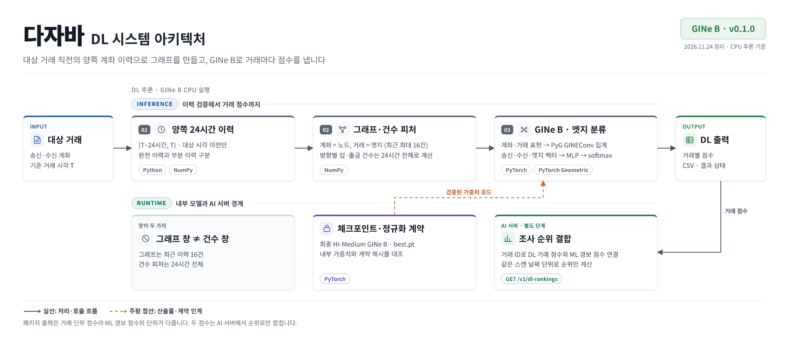

# 다자바 DL

거래별 점수를 계산하는 GINe B 추론 패키지다. 각 대상 거래 시각 T 기준 송·수신 양쪽 계좌의 `[T−24시간, T)` 이력을 입력으로 사용한다.

## 시스템 아키텍처

그래프에는 양쪽 계좌에서 모은 최근 거래를 최대 16건 사용한다. 방향별 입·출금 건수는 24시간 전체 이력에서 계산한다. `dajaba-dl-score`는 원본 파일명(`source_file`)과 헤더 다음 행부터 1로 센 행 번호(`source_row_number`)를 키로 거래별 점수를 `transaction_scores.csv`에 쓰고 실행 정보를 `result.json`에 기록한다.

AI 서버는 원본 키와 백엔드 거래 ID의 매핑으로 DL 점수를 경보의 근거 거래에 연결한다. `GET /v1/dl-rankings/{scan_date}`는 같은 스캔 날짜의 ML 경보 점수와 DL 거래 점수를 이용해 조사 순위를 제공한다. 공식 경보 점수는 ML이 계산하고 위험 등급은 백엔드가 결정한다. [AI 서버의 조사 순위 계산 규칙](https://github.com/dajaba-team/dajaba-ai/blob/f31fbfdfed44468814922167f10247c831431dc4/docs/scoring/01_dl_investigation_ranking.md)

보존된 전수 추론은 로컬에서 검증했다. GitHub CI 구성은 후속 작업이다.

## 설치 및 실행

Python 3.9의 새 가상환경에서 다음을 실행한다.

~~~sh
python -m pip install --index-url https://download.pytorch.org/whl/cpu torch==2.3.1
python -m pip install . pytest
python -m pip check
python -m pytest -q
dajaba-dl-score --help
~~~

승인된 내부 체크포인트와 해당 정규화 계약을 함께 전달받아 경로를 지정한다.

~~~sh
dajaba-dl-score --checkpoint ./private-models/best.pt --config ./private-models/dl_contract.json --transactions ./local-inputs/transactions.csv --coverage ./local-inputs/coverage.csv --output ./local-results --device cpu
~~~

[입력 계약 및 모델 확인](docs/INFERENCE.md)을 참고한다. 합성 테스트는 자체 체크포인트를 생성한다. 이 저장소에는 실제 가중치·학습 정규화 값·거래 데이터가 포함되지 않는다.
